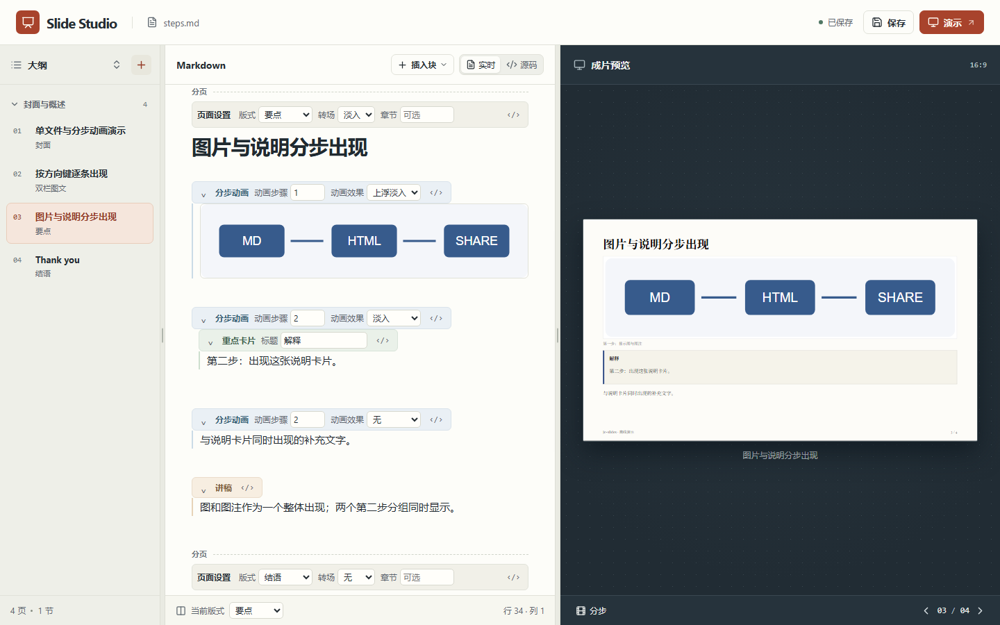

<p align="center">
  
</p>

# md-slide-studio

> [中文版](README_zh.md) | [Live Demo](https://panwanke.github.io/md-slides/)

md-slide-studio (md-slides) is a standalone Markdown academic slide workbench and offline rendering engine featuring real-time CodeMirror 6 live editing, bidirectional source mapping, and instant HTML presentation generation.



## Overview

md-slide-studio decouples presentation authoring from external agent environments into a clean, standalone toolchain. It provides an intuitive desktop/browser-based workspace designed specifically for academic and technical presentations.

Key views and workflows include:
- **Interactive Workbench**: A three-pane layout featuring an Accordion Section Navigator, a CodeMirror 6 live-editing Markdown workspace with visual block widgets, and an instant slide preview iframe.
- **Bidirectional Source Mapping**: Selecting slides or chapters in the outline updates the preview; clicking rendered elements in the presentation automatically scrolls and highlights the corresponding Markdown source block.
- **Controlled Atomic Writebacks**: Quickly modify slide layouts, chapters, speaker notes, and fragment steps through UI controls, persisting changes directly back into the Markdown source file via atomic patch transactions.
- **Standalone Offline Bundling**: Packages 36 academic themes, offline fonts, and slide runtime assets into self-contained single-file HTML presentations with zero external server dependencies.

## CLI Commands

| Command | Description |
|---------|-------------|
| `md-slide-studio doctor` | Check environment, dependencies, and font assets health status |
| `md-slide-studio check <deck.md>` | Validate Markdown syntax, slide delimiters, frontmatter, and assets |
| `md-slide-studio render <deck.md> --out <DIR>` | Compile Markdown into a standalone offline HTML presentation |
| `md-slide-studio edit <deck.md>` | Launch the interactive local studio workbench |
| `md-slide-studio preview <deck.md>` | Launch a lightweight live-reloading presentation preview server |
| `md-slide-studio serve` | Start the account-based deck library (server-side storage, no bound file) |

### GitHub Pages workspace

In the online editor, choose **File → Open Markdown** (文件 → 打开 Markdown) or press `Ctrl/⌘ + O` to open one or more local files. Choose **File → Open workspace folder** (文件 → 打开工作文件夹) to open a folder with Markdown and images. Each file or folder opens in its own tab. Use the dropdown beside the tabs to choose a deck within a folder. Switching tabs or decks keeps your edits in the current session.

The **File** menu also lists recent Markdown files and projects. Reopening a project returns to its last active deck. Depending on browser permissions, you may need to grant access again or reselect the original file or folder.

Image paths are relative to each Markdown file, including parent directories within the selected folder. Use angle brackets around paths with spaces, as in ``.

HTML export embeds the local images. When your browser grants write access, **Save locally** (保存到本地) writes changes to the original Markdown file. The read-only directory picker supports **Export .md**.

Use **Settings** (设置) to change the shortcuts for opening Markdown, opening a workspace folder, and saving. Shortcuts are stored in your browser. **GitHub · Star** opens the project repository in a new tab.

### Deck library mode

`serve` starts the same workbench with a sign-in screen and a deck library:
decks are stored in a server-side SQLite database, every save keeps a full
revision snapshot, and each account only sees its own decks. Importing one Markdown file opens it in the editor. Import a folder
to upload Markdown and images together while preserving their relative paths.
To add images after import, use the **Images** (图片) panel in the deck editor.
Uploads are stored under `assets/` in the studio data directory.

```bash
md-slide-studio serve --port 9000
# Database: ~/.md-slide-studio/studio.db
# Override with MD_STUDIO_DB=/path/to/studio.db or MD_STUDIO_DATA_DIR=/path/to/dir
```

The API contract is documented in [docs/protocol.md](docs/protocol.md).

## Quick Start

### Installation

```bash
# Clone the repository
git clone https://github.com/panwanke/md-slides.git
cd md-slides

# Install Python package with dev & test dependencies
pip install -e ".[dev]"

# Build the frontend workbench (required once before running edit / serve from source)
cd web
npm install
npm run build
cd ..
```

> **Note**: Command-line rendering (`md-slide-studio render`) is powered solely by the Python engine and **does not require Node.js or frontend building**. Only the interactive browser workbench (`edit` / `serve`) requires the prebuilt frontend assets.

### CLI & Studio Usage

```bash
# Check environment health
md-slide-studio doctor

# Launch the interactive live-editing workbench (opens http://localhost:8000)
md-slide-studio edit sample.md

# Render deck to a standalone HTML file (pure Python offline engine)
md-slide-studio render sample.md --out ./dist
```

In the studio workbench, live preview is enabled by default. Switch to "Source" to edit raw Markdown tokens, use "Insert Block" to insert callouts, cards, or step-by-step animations, check animation order in "Fragments", and click "Present" to open a presentation window from the current slide.

### Frontend Development & Hot Reload

The web studio is built with React 18, Vite, and CodeMirror 6 in the `web/` directory:

```bash
cd web
npm install
npm run dev    # Start Vite dev server on port 3000 (proxies API to 8000)
npm run build  # Rebuild and package frontend assets into src/md_slide_studio/web_dist/
```

## Features

- **Standalone Execution**: Fully decoupled from agent environments; runs as an independent Python package and web workbench.
- **Accordion Section Navigation**: PowerPoint-style collapsible sections and chapters for organizing large slide decks.
- **CodeMirror 6 Live Editing**: In-editor Markdown typography, layout configuration widgets, speaker notes, and container components with native undo/redo.
- **Bidirectional Synchronization**: Seamless position alignment between outline, editor cursor, and presentation canvas.
- **Batteries-Included Offline Engine**: Built-in academic color palettes, CJK fonts, KaTeX math typesetting, and syntax highlighting.
- **Comprehensive Quality Gates**: Rigorous test suite covering AST parsing, round-trip serialization, WebSocket transactions, and Playwright end-to-end browser workflows.

## Tech Stack

| Component | Technology |
|---|---|
| Core Engine & CLI | Python 3.11+, Click, Jinja2, Pydantic |
| Local Backend Server | FastAPI, Uvicorn, WebSockets, Watchfiles |
| Studio Frontend | React 18, TypeScript, Vite |
| Editor & Live Preview | CodeMirror 6, custom syntax decorations |
| Presentation Runtime | Reveal.js, KaTeX, Highlight.js |
| Testing & Verification | Pytest, Pytest-Asyncio, Playwright |

## License

MIT
