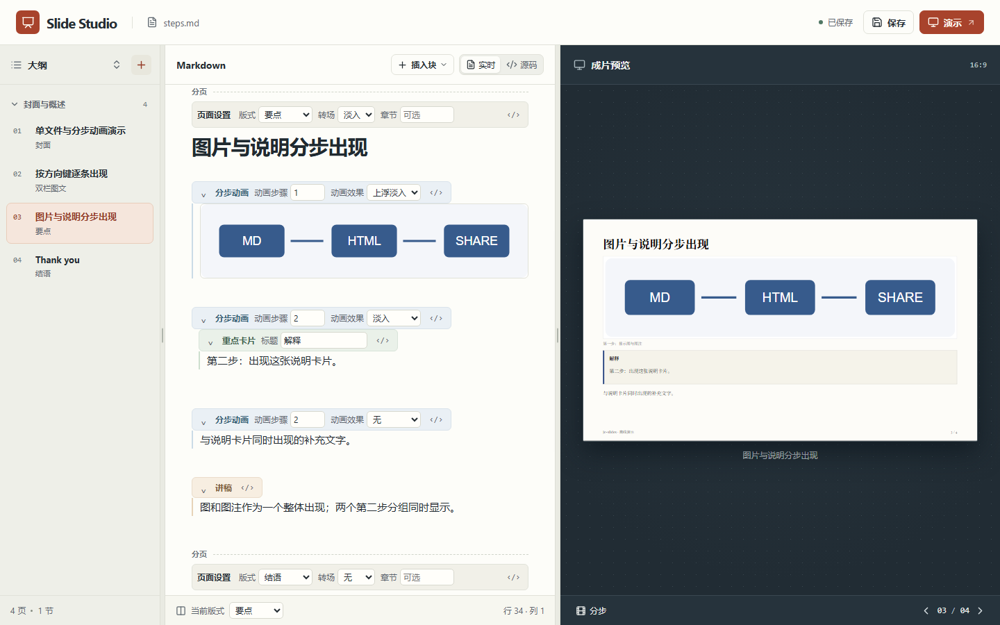

<p align="center">
  
</p>

# jc-slide-studio

> [English](README.md) | [在线演示](https://panwanke.github.io/md-slides/)

jc-slide-studio (md-slides) 是专为学术研究汇报与复杂演示稿设计的 Markdown 幻灯片工作台与独立离线渲染引擎。提供 CodeMirror 6 实时编辑排版、源码与成片双向定位、多栏拖拽及开箱即用的离线 HTML 演示打包。



## 概述

jc-slide-studio 将幻灯片制作与 Agent 环境完全解耦，提供独立的 Python 与 Web 完整工具链，专为学术演讲、开题答辩、论文分享与技术汇报设计。

主要面板与工作流包括：
- **交互式工作台**：三栏式布局，包含手风琴式分节导航大纲、集成专有标记可视化卡片的 CodeMirror 6 实时编辑区，以及即时成片预览 iframe。
- **双向联动与源码定位**：在大纲中切换章节或光标即时跟随成片；在成片预览中点击任意元素，自动平滑滚动并高亮选中 Markdown 源码对应区间。
- **受控原子回写**：在工作台控件中直接调整幻灯片版式、分节属性、演说者讲稿与分步动画，通过受控事务原子回写 Markdown 源文件，保障排版规范与撤销历史一致。
- **独立离线打包**：内置 36 套学术演示主题、中文字体与播放运行时，无需外网与独立后端依赖即可一键编译为单文件离线 HTML。

## 命令行工具

| 命令 | 功能说明 |
|---|---|
| `jc-slide-studio doctor` | 检查本地环境、Python 依赖与字体资产健康状态 |
| `jc-slide-studio check <deck.md>` | 静态校验 Markdown 语法、分页分隔符、元数据与静态资源 |
| `jc-slide-studio render <deck.md> --out <DIR>` | 将 Markdown 编译为完全自包含的独立离线 HTML 演示稿 |
| `jc-slide-studio edit <deck.md>` | 启动本地交互式编辑工作台 |
| `jc-slide-studio preview <deck.md>` | 启动轻量热重载预览服务器 |
| `jc-slide-studio serve` | 启动带账号系统的幻灯片库（数据存于服务端） |

### GitHub Pages 工作文件夹

在在线演示中进入「在线编辑」，点击「打开工作文件夹」，选择包含 Markdown 和图片的目录。图片路径以该 Markdown 的所在目录为起点，支持文件夹内的上级引用。带空格的路径可写成 ``。

本地图片会嵌入导出的 HTML。浏览器授权写入后，可点「保存到本地」写回原 Markdown 文件。通过只读目录选择器打开时，使用「导出 .md」保存编辑稿。

### 幻灯片库模式

`serve` 不绑定本地文件，浏览器打开后先登录，再进入「我的演示稿」：
正文保存在服务端数据库，每次保存留下完整版本快照，账号之间数据隔离；
可一次导入多个本地 `.md`。用「导入文件夹（含图片）」一起上传 Markdown 和图片，可保留目录结构与相对引用。进入演示稿后，也可在「图片」面板追加上传并插入 Markdown 引用。

```bash
jc-slide-studio serve --port 9000
# 数据库默认：~/.jc-slide-studio/studio.db
# 可用 JC_STUDIO_DB=/path/to/studio.db 或 JC_STUDIO_DATA_DIR=/path/to/dir 改位置
```

接口契约见 [docs/protocol.md](docs/protocol.md)。

## 快速开始

### 安装环境

```bash
# 克隆仓库
git clone https://github.com/panwanke/md-slides.git
cd md-slides

# 开发模式安装核心包
pip install -e .

# 或包含测试与开发依赖安装
pip install -e ".[dev]"
```

### CLI 与工作台使用

```bash
# 环境健康体检
jc-slide-studio doctor

# 启动本地实时编辑工作台
jc-slide-studio edit sample.md

# 编译为单文件离线 HTML
jc-slide-studio render sample.md --out ./dist
```

工作台默认打开「实时」编辑排版模式。点「源码」可编辑原始 Markdown 标记；讲稿、重点卡片与分步动画可直接通过顶部「插入块」添加；右侧「分步」面板用于查看和调整动画播放顺序；顶栏「演示」按钮可从当前页全屏打开独立播放窗口。

### 前端开发（可选）

工作台编译后的前端静态资源已内置于 Python 包（`src/jc_slide_studio/web_dist`）。如需二次开发 React 前端：

```bash
cd web
npm install
npm run dev    # 启动 Vite 开发服务（默认端口 3000，API 代理至 8000）
npm run build  # 重新打包构建前端产物至 web_dist
```

## 功能特性

- **脱离环境独立运行**：脱离 Agent 约束，作为独立 Python/Web 软件发行与使用。
- **PPTX 风格分节导航**：手风琴式可折叠分节跳转，轻松组织数十页长演示稿。
- **CodeMirror 6 实时排版**：编辑区支持 Markdown 所见即所得排版、版式选择控件、专有容器卡片与原生撤销重做。
- **双向协同定位**：大纲、光标与成片画布三向毫秒级双向聚焦。
- **开箱即用离线引擎**：内置丰富学术配色、CJK 字体、KaTeX 数学公式渲染与代码语法高亮。
- **完整质量守门**：包含 AST 解析、往返无损序列化、WebSocket 事务与 Playwright 端到端浏览器自动化全套测试。

## 技术栈

| 模块组件 | 技术选型 |
|---|---|
| 核心引擎与 CLI | Python 3.11+, Click, Jinja2, Pydantic |
| 本地服务与通信 | FastAPI, Uvicorn, WebSockets, Watchfiles |
| 工作台前端 | React 18, TypeScript, Vite |
| 编辑器与排版 | CodeMirror 6, 自定义语法装潢 |
| 播放运行时 | Reveal.js, KaTeX, Highlight.js |
| 质量测试与端到端 | Pytest, Pytest-Asyncio, Playwright |

## 许可证

MIT
